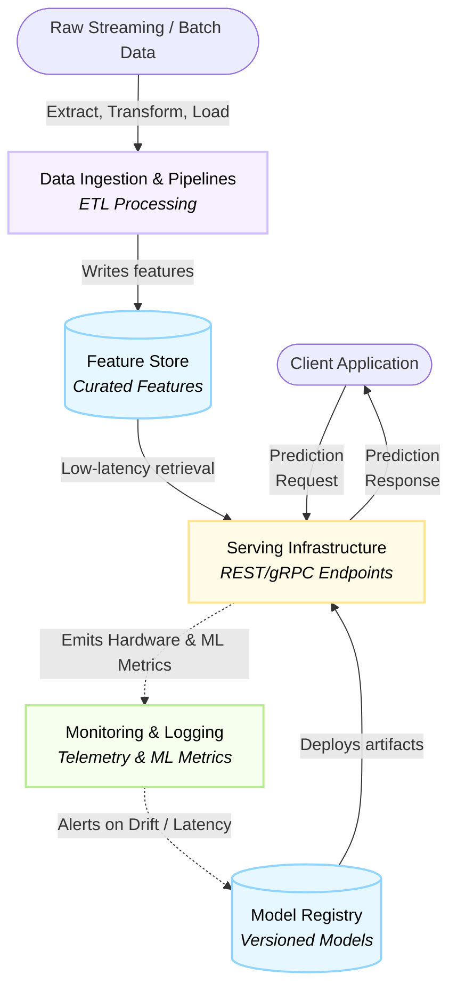
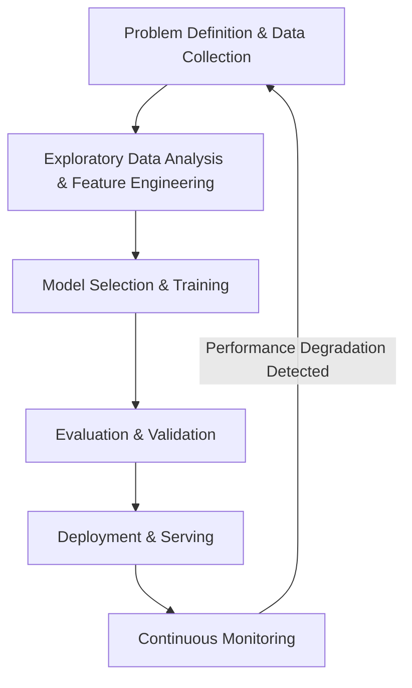

# Introduction to AI System Operations

**Session Time:** 120 minutes

---

## Table of Contents
1. Key Components of AI-Enabled Systems
2. The Lifecycle of AI Models
3. Operational Practices for Reliability
4. Lab Reference: System Landscape Mapping
5. Tools and Resources

---

## Module Overview

Learn the fundamentals of maintaining and managing AI-enabled systems in production. Transitioning a machine learning model from a static Jupyter notebook to a live, reliable system requires a significant paradigm shift. In this module, you will understand how data pipelines, models, and applications interact continuously across the entire system lifecycle.

---

## 1. Key Components of AI-Enabled Systems

**Learning Objective:** Describe the key components of AI-enabled systems and their interdependencies.

An operational AI system is a complex, interconnected web of infrastructure, data pipelines, and software engineering components.  Understanding these interdependencies is critical for ensuring system reliability and scalability.

**Core Components:**
1. **Data Ingestion & Pipelines:**
   <br/> The mechanisms that extract, transform, and load (ETL) streaming or batch data into a format the model can consume. <br/> <br/> 
2. **Feature Store:** 
   <br/> A centralized repository for storing documented, curated, and access-controlled features used for both training and low-latency serving. <br/> <br/> 
3. **Model Registry:** 
   <br/> A version control system specifically for machine learning models, tracking metadata, hyperparameters, and artifacts. <br/> <br/> 
4. **Serving Infrastructure:** 
   <br/> The compute environments (e.g., Kubernetes clusters, serverless functions) that host the model and expose it via REST or gRPC endpoints. <br/> <br/> 
5. **Monitoring & Logging:** 
   <br/> Telemetry systems that track hardware metrics (CPU, memory) and ML-specific metrics (prediction distributions, latency).<br/> <br/> 


<br/> <br/> 

**Practical Example: Dynamic Pricing Engine**
<br/> Consider a dynamic pricing engine for a ride-sharing application. 
* The **Data Pipeline** processes live weather and traffic data. 
* The **Feature Store** provides historical rider demand profiles. 
* The **Serving Infrastructure** hosts the pricing model, which must return a fare prediction in under 100 milliseconds. 
If the data pipeline lags, the model serves pricing based on stale traffic data, leading to a poor user experience and lost revenue, even if the model's internal logic is mathematically perfect.

```mermaid
flowchart TD
    %% Inputs
    DP[🚰 Data Pipeline<br/>Live Weather 🌧️ & Traffic 🚗]
    FS[(🗄️ Feature Store<br/>Historical Demand Profiles 📊)]
    
    %% Core Engine
    SI[⚡ Serving Infrastructure<br/>Pricing Model 🧠]
    
    %% Output/Consumer
    User((📱 Rider App))
    
    %% Failure Mode
    Warning>⚠️ Critical Bottleneck:<br/>If Pipeline Lags, Data is Stale]
    Result[📉 Lost Revenue & Poor UX]
    
    %% Connections
    DP -->|Feeds Real-Time Data| SI
    FS -->|Feeds Historical Data| SI
    User -->|Requests Fare| SI
    SI -->|Returns Prediction 💵<br/>Latency < 100ms ⏱️| User
    
    %% Failure Path Connections
    Warning -.->|Impacts| DP
    Warning -.->|Leads to| Result
    
    %% Styling for emphasis
    style Warning fill:#000000,stroke:#ff0000,stroke-width:2px
    style Result fill:#000000,stroke:#ff9900
```

<br/> 


<br/> 

---

## 2. The Lifecycle of AI Models

**Learning Objective:** Explain the lifecycle of AI models from development to production.

The machine learning workflow requires continuous iteration. A typical ML workflow consists of the following stages: 
- Problem Definition & Business Understanding
- Data Collection & Preprocessing
- Exploratory Data Analysis (EDA)
- Feature Engineering
- Model Selection & Training
- Evaluation & Validation
- Deployment & Monitoring. 

Unlike traditional software, an AI model's lifecycle does not end at deployment; it enters a continuous loop of serving, monitoring, and retraining to adapt to real-world changes.



**Practical Example: Fraud Detection System**

A model is trained on historical transaction data and evaluated against a holdout dataset to ensure high precision and recall. Once deployed, it begins scoring live credit card transactions. However, fraudsters constantly change their tactics. The lifecycle must include a feedback loop where newly identified fraudulent patterns are fed back into the data collection phase for continuous retraining, ensuring the model does not become obsolete.

---

## 3. Operational Practices for Reliability

**Learning Objective:** Analyse how operational practices maintain performance and reliability in deployed AI systems.

Deployed models degrade over time because the real world changes. Operational practices in MLOps focus on detecting this degradation and automating the remediation process to maintain reliability.

**Key Operational Practices:**

* **Data Drift Monitoring:** 
  <br/> Tracking shifts in the statistical distribution of incoming production data compared to the original training data. <br/><br/>
* **Concept Drift Monitoring:** 
  <br/> Tracking changes in the relationship between input features and the target variable (e.g., a sudden economic shift changes purchasing behavior). <br/><br/>
* **Continuous Training (CT):** 
  <br/> Automating the pipeline to retrain the model when performance degrades or when new data thresholds are met. <br/><br/>
* **Shadow Deployment:** 
  <br/> Running a new model version alongside the current production model, logging its predictions without returning them to the user, to safely evaluate real-world performance. <br/><br/>


### **Technical Suggestion: Detecting Data Drift**

Below is a Python approach using `pandas` to load feature logs and a Kolmogorov-Smirnov (KS) test to detect if the distribution of a specific feature has drifted significantly from the training baseline.

**Pre-requisite installation:**

```bash
pip install scipy pandas

```

**Python code example:**

```python
from scipy.stats import ks_2samp
import pandas as pd

# --- Load and inspect feature distributions ---
df_features = pd.read_csv("feature_distributions.csv")
print("Data Preview:\n", df_features.head())
reference_feature_data = df_features['training_feature_X'].dropna().values
production_feature_data = df_features['production_feature_X'].dropna().values

# Perform KS test to compare distributions
statistic, p_value = ks_2samp(reference_feature_data, production_feature_data)

# Analyze the p-value against a threshold (e.g., 0.05)
if p_value < 0.05:
    print(f"\nALERT: Significant Data Drift Detected! (p-value: {p_value:.4f})")
    # Trigger alerting or retraining pipeline here
else:
    print(f"\nSystem Normal: No significant drift detected. (p-value: {p_value:.4f})")

```

> [!TIP]
> 
> When implementing this in a real CI/CD or MLOps pipeline, you would likely replace the local `"feature_distributions.csv"` with a dynamic query to your **Feature Store**. You can then use the `head()` or `describe()` functions to quickly validate the data schema before running the statistical tests.

---

## 4. Lab Reference: System Landscape Mapping

**Lab Objective:** Visualise how data, models, and services connect within an operational AI system using Draw.io and AWS Free Tier concepts. This lab helps learners understand dependencies and the flow between components in a live environment.

**Deliverable:** A Draw.io architecture diagram explaining an operational AI system submitted as a PNG file

> [!NOTE]
>
> [Lab: System Landscape Mapping](https://git.generalassemb.ly/ai-systems-engineering-reliability/lab-1-system-landscape-mapping)
> 
> Note: Please refer to the dedicated [Lab Guide](https://git.generalassemb.ly/ai-systems-engineering-reliability/lab-1-system-landscape-mapping)
 for full instructions, architectural constraints, and deliverables.* 


---

## 5. Tools and Resources

The following tools will be utilized in this module to map and understand operational environments:

* **GitHub:** For version control of infrastructure and model configurations.
* **Draw.io (free online):** For creating system landscape diagrams and architecture workflows.
* **AWS Free Tier:** For exploring real-world cloud components (e.g., S3 for data lakes, SageMaker for model registries).
