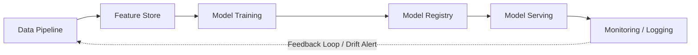

# Instructor Guide: Introduction to AI System Operations

## Module Overview
Learn the fundamentals of maintaining and managing AI-enabled systems in production. Understand how data pipelines, models, and applications interact across the system lifecycle. This module bridges the gap between data science experimentation and robust software engineering, emphasizing that deploying a model is the beginning, not the end, of its lifecycle.

## Learning Objectives
By the end of this session, students will be able to:
* Describe the key components of AI-enabled systems and their interdependencies.
* Explain the lifecycle of AI models from development to production.
* Analyse how operational practices maintain performance and reliability in deployed AI systems.

## Session Pacing Guide (120 Minutes total)

| Duration | Segment | Instructor Action |
| :--- | :--- | :--- |
| **10 min** | **Module Overview & Introduction** | State objectives and set expectations. Ask the room: *"Who here has deployed a model, and who has had to wake up at 2 AM because it broke?"* |
| **30 min** | **Key Components of AI Systems** | Draw an end-to-end AI architecture on the whiteboard. Map ML-specific terms (Feature Store, Model Registry) to standard software equivalents (Database, Artifact Repo). |
| **30 min** | **The Lifecycle of AI Models** | Walk through the continuous ML workflow (Problem Definition to Deployment & Monitoring). Contrast this circular lifecycle with the traditional linear SDLC. |
| **30 min** | **Operational Practices for Reliability** | Discuss Concept Drift vs. Data Drift. Show the Python KS-test code snippet live. Emphasize automation in MLOps. |
| **15 min** | **Lab: System Landscape Mapping** | Facilitate the Draw.io lab. Circulate and review architectural decisions, looking for missing monitoring or feedback loops. |
| **5 min** | **Wrap-Up & Reflection** | Lead a brief Q&A and summarize the importance of treating ML models as dynamic software entities. |

---

## Delivery Notes & Teaching Tips

### 1. Key Components of AI-Enabled Systems
* **The "Microservices" Analogy:** Mid-career professionals are likely familiar with microservices. Frame the ML components (Data Pipeline, Feature Store, Model Serving) as specialized microservices that must communicate efficiently. 
* **Whiteboarding is Key:** Do not just rely on slides. Draw the system out dynamically. Start with the user, then the application, then back into the serving endpoint, and finally the data pipelines that feed it. 
* **Focus on the Bottlenecks:** Emphasize that the model itself is often the smallest part of the system. Spend time discussing how a brittle data pipeline compromises the entire system.

### 2. The Lifecycle of AI Models
* **Concept Check:** Ensure students understand that ML workflows are highly iterative. Walk through the stages: Problem Definition & Business Understanding, Data Collection & Preprocessing, Exploratory Data Analysis (EDA), Feature Engineering, Model Selection & Training, Evaluation & Validation, and Deployment & Monitoring.
* **Visualizing the Loop:** Use the following Mermaid diagram or draw it live to illustrate that "Deployment" feeds back into "Problem Definition & Data Collection" when degradation occurs.

### 3. Operational Practices for Reliability

* **Data Drift vs. Concept Drift:** This is a crucial distinction.
* *Data Drift:* The inputs change (e.g., users are suddenly much older than the training demographic).
* *Concept Drift:* The underlying reality changes (e.g., a global pandemic changes what "normal" purchasing behavior looks like).

* **Live Code Demo:** Walk through the Kolmogorov-Smirnov (KS) test Python script from the module content. Explain *why* a statistical test is needed rather than just "looking at the data."
* **AI Integration Tip:** Have students prompt an AI tool (like Gemini or ChatGPT) with: *"Generate a Python script to detect concept drift using the Page-Hinkley test on a simulated streaming dataset."* This helps them see alternative detection methods beyond the KS test.

---

## Lab Guide: System Landscape Mapping

**Lab Objective:** Visualise how data, models, and services connect within an operational AI system using Draw.io and AWS Free Tier concepts. This lab helps learners understand dependencies and the flow between components in a live environment.

### Setup

* Ensure students have access to Draw.io (web version).
* Ensure students have their AWS Free Tier accounts ready (mostly for referencing service documentation like SageMaker, S3, or CloudWatch).

### Common Student Issues & Solutions

* **Issue:** "I don't know which AWS service corresponds to a Feature Store or Model Registry."
* *Solution:* Direct them to AWS SageMaker documentation. Remind them that for this exercise, logical components (e.g., drawing a box labeled "Feature Store") are more important than vendor-specific names, though tying them to AWS is a good stretch goal.

* **Issue:** Forgetting the feedback loop.
* *Solution:* Many software engineers will draw a linear pipeline ending at the API gateway. Prompt them: *"How does the system know when to retrain? Where do the logs go?"*

### Debrief Questions

At the end of the lab, ask:

1. "In the architecture you drew, where is the single point of failure that would take down the model's predictions?"
2. "How did you represent the model retraining trigger? Is it manual, scheduled, or event-driven based on drift metrics?"

---

## Resources for the Instructor

* **Reference:** [AWS Machine Learning Lens - Well-Architected Framework](https://docs.aws.amazon.com/wellarchitected/latest/machine-learning-lens/machine-learning-lens.html)
* **Reference:** [Google Cloud: MLOps Continuous Delivery and Automation Pipelines](https://cloud.google.com/architecture/mlops-continuous-delivery-and-automation-pipelines-in-machine-learning)
* **AI Prompt Bank:** Keep these handy for students exploring operational concepts:
* *"Explain the difference between a Data Warehouse and a Feature Store to a software engineer."*
* *"What are the trade-offs between shadow deployment and canary deployment for a machine learning model?"*
